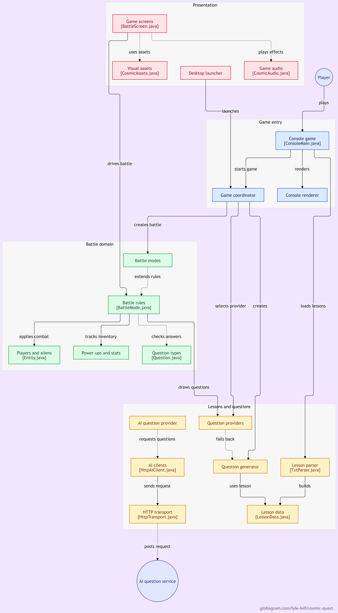
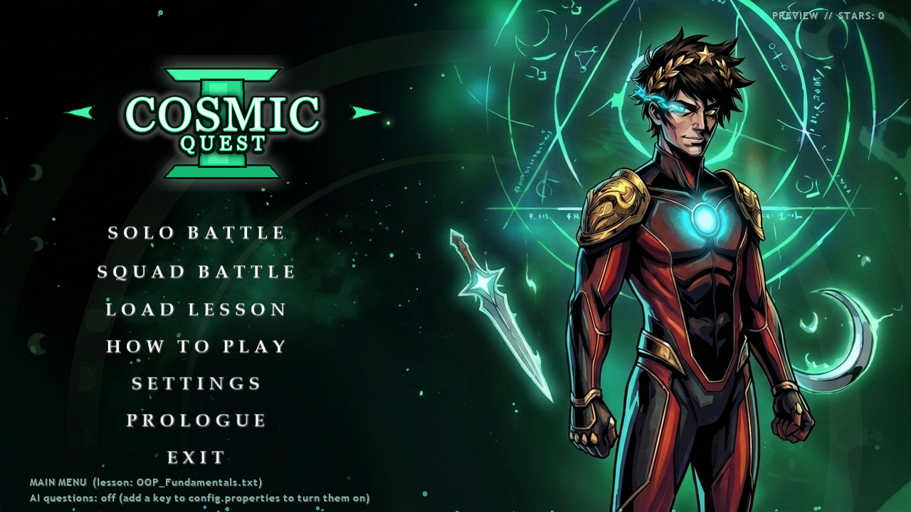
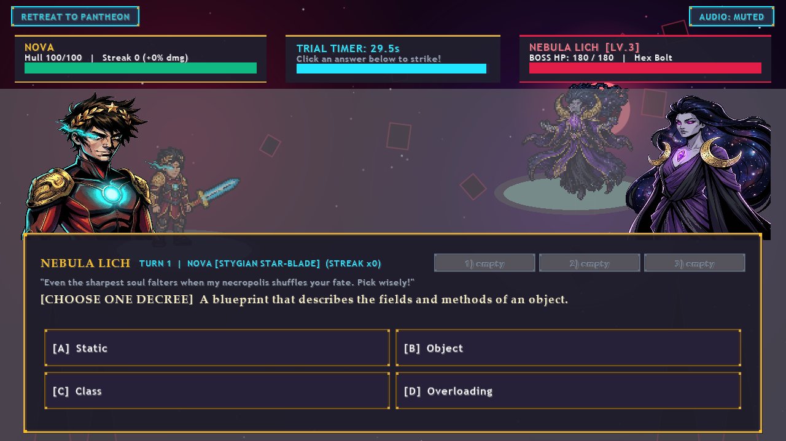
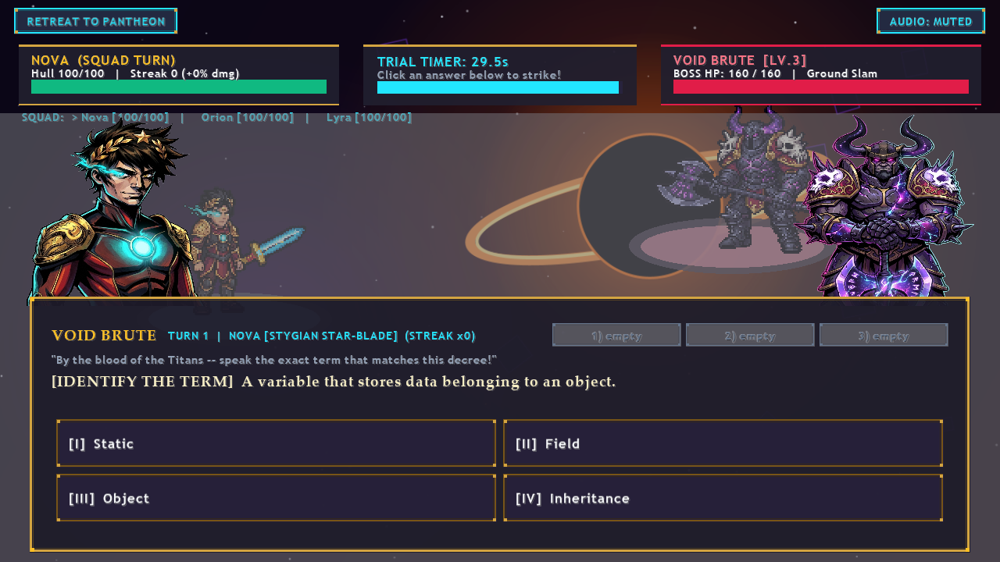
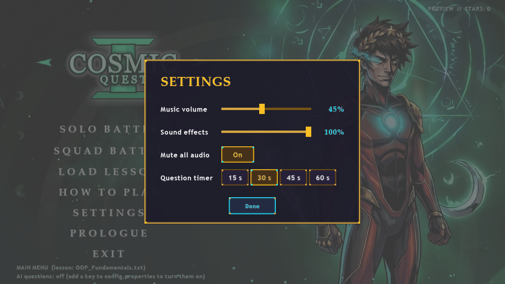
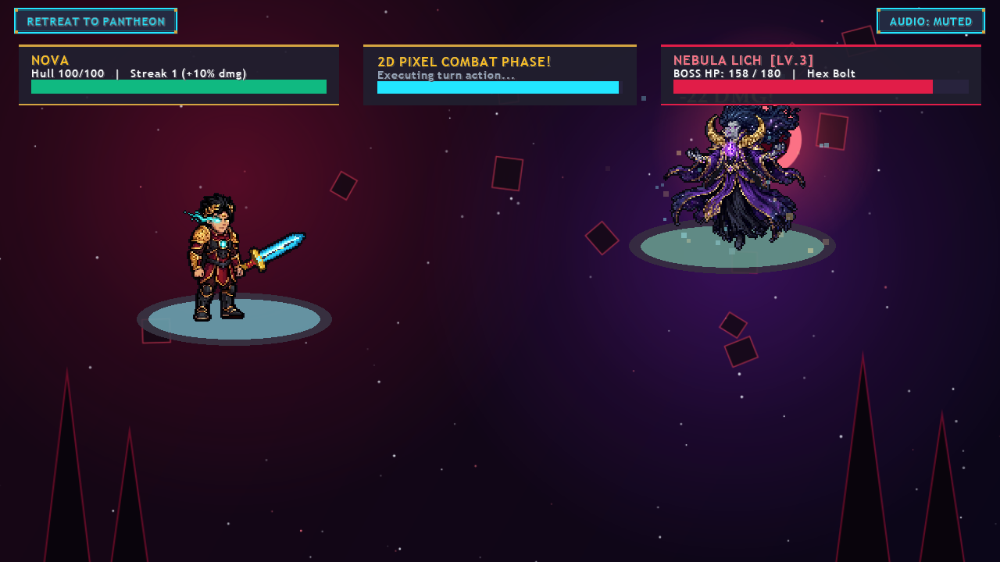
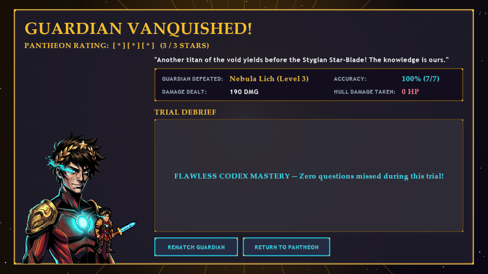

# Cosmic Quest

## Project Overview

Cosmic Quest is a Java desktop study battle game that turns lesson notes into
quiz encounters against alien guardians. Load a formatted `.txt` lesson,
choose a cadet and an enemy, and answer questions to attack. Missed answers
give the enemy a chance to strike back, while the mission debrief helps you
review what you need to study again.

Developed by **NeuroLink**, Team 8 of **CS-2103**, for **OOP 101 —
Object-Oriented Programming** at **Batangas State University, The National
Engineering University, Alangilan Campus**.

## Tagline

> Turn your lessons into cosmic victories.

## Project Features

- **Bring your own lesson.** Load terms, definitions, and lists from a `.txt`
  file. The parser reports malformed lines with their line numbers.
- **Four alien trials.** Void Brute asks identification questions, Star Weaver
  asks reasoning questions, Nebula Lich asks multiple-choice questions, and
  Lunar Beast asks enumeration questions.
- **Solo battles.** Challenge any guardian at threat Level 1, 2, or 3.
- **Local Squad battles.** Two or three cadets take turns on one computer
  against a Level 3 boss. Defeated cadets are skipped.
- **Streak-based combat.** Correct answers increase damage by 10% per streak,
  up to a 50% bonus. Partial enumeration answers can deal partial damage.
- **Four power-ups.** Shield blocks one hit, Repair restores 20 hull,
  Double Damage boosts the next damaging hit, and Hint helps with the current
  question. Every third consecutive correct answer earns a random power-up
  when an inventory slot is free.
- **Personal Squad inventories.** Each cadet keeps their own streak, score,
  and three power-up slots. The displayed inventory follows the current player.
- **Question recycling.** Questions are shuffled, missed questions return to
  the pool, and depleted pools refill during longer battles.
- **Optional AI questions.** Gemini and Groq can generate questions from the
  loaded lesson, with local generation as the fallback.
- **Mission debrief.** Review accuracy, damage, stars, and missed questions
  with their correct answers after victory, defeat, or retreat.
- **Console and desktop interfaces.** Both use the same Java battle rules.

### Added Desktop Features

- **Saved Settings.** Separate music and effects volume sliders, mute, and a
  15-, 30-, 45-, or 60-second question timer. Choices save automatically and
  return at startup. The first launch uses 45% music, 100% effects, audio on,
  and a 30-second timer.
- **Background AI loading.** A loading dialog stays visible while the first
  questions are requested, and later AI refills also run in the background.
- **Prologue playback.** Watch the opening video at startup or replay it from
  the menu. Skip or Esc returns to the menu, and saved mute also applies to it.
- **Character Codex.** Browse cadet and enemy portraits, pixel sprites, and
  descriptions of their combat rules through How to Play.
- **Animated combat.** Question cards lead into pixel battle sequences with
  attack animations, damage numbers, screen shake, and screen fades.
- **Music and effects.** Menu, enemy, and Squad music accompany synthesized
  clicks, attacks, power-up activation, and result sounds.
- **Responsive layouts.** The desktop window supports resizing, with a minimum
  size of 960 × 540. Long debriefs scroll within the results screen.

## OOP Principles Applied

- **Encapsulation.** `Player` keeps hull, score, and streak private. Methods
  such as `takeDamage()`, `heal()`, and `increaseStreak()` control changes.
  `Question` also keeps its text, answer, and difficulty private.
- **Inheritance.** `VoidBrute`, `StarWeaver`, `NebulaLich`, and `LunarBeast`
  extend `Entity`. The four question classes extend `Question`, while
  `SoloBossBattle` and `SquadBossBattle` extend `BattleMode`.
- **Polymorphism.** Every question implements `checkAnswer()` for its own
  answer format. Enemy subclasses override special-move behaviour, and
  `Hint`, `Shield`, `Repair`, and `DoubleDamage` implement their own `apply()`
  effects through the shared `PowerUp` type.
- **Abstraction.** Abstract classes `Entity`, `Question`, `BattleMode`, and
  `PowerUp` define shared contracts. The `QuestionProvider` interface lets
  battles request questions from either local or AI providers. The separate
  AI module uses `AiClient` and `HttpTransport` interfaces.

Composition connects these classes. A `Team` contains players, a battle owns
a question pool and match statistics, and each player's inventory holds power-ups.

## Project Structure

```text
Cosmic-Quest/
├── core/
│   └── src/
│       ├── main/java/com/neurolink/cosmicquest/
│       │   ├── CosmicQuestGame.java   # Desktop game coordinator
│       │   ├── GameSettings.java      # Saved desktop preferences
│       │   ├── model/                 # Players, teams, aliens, question types
│       │   ├── logic/                 # Parsing, battles, power-ups, statistics
│       │   ├── screens/               # Menu, prologue, codex, battles, results
│       │   ├── ui/                    # Assets, theme, audio, shared UI helpers
│       │   └── console/               # Terminal menu and renderer
│       └── test/java/                 # Game and console tests
├── ai/                               # API clients, configuration, HTTP, tests
├── lwjgl3/                           # Desktop launcher and packaging
├── assets/                           # Lessons, art, fonts, music, prologue
├── docs/                             # Guides, diagrams, screenshots
├── config.properties.example          # Optional AI configuration template
├── CREDITS.md                         # Credits and asset-source checklist
└── gradlew / gradlew.bat              # Gradle launchers
```

### GitDiagram

This architecture image was exported from GitDiagram's published repository
snapshot, drawn on November 24, 2026. The local saved-settings addition appears
in the folder structure above. Explore the diagram and linked source files
on [GitDiagram](https://gitdiagram.com/lyle-leif/cosmic-quest).

<details open>
<summary>View the GitDiagram image</summary>



</details>

## How to Run the Game

### Requirements

- **JDK 21** installed, with `java` available in your terminal.
- A desktop with graphics and audio support.
- Internet access for the first Gradle dependency download and for optional AI
  requests. Local questions support offline play once the game is built.

Open a terminal in the `Cosmic-Quest` project folder. The Gradle Wrapper supplies
the required Gradle version.

### Launch the Desktop Game

On Windows, use PowerShell.

```powershell
.\gradlew.bat lwjgl3:run
```

On macOS or Linux, use the shell wrapper.

```sh
./gradlew lwjgl3:run
```

The prologue opens first. Skip it or press Esc to reach the main menu. The
sample `OOP_Fundamentals.txt` lesson loads automatically. Choose **Solo Battle**
or **Squad Battle** and follow the setup prompts. Click the answer cards during
questions and use occupied power-up slots before submitting an answer.

Open **Settings** to adjust audio and the timer. Changes apply immediately and
save automatically. **Done** or **Esc** closes the Settings dialog.

### Load Your Own Lesson

Save a UTF-8 text file using this format. This example has four different terms
for multiple choice, detailed definitions for reasoning, and a list for enumeration.

```text
# Computer Basics
CPU :: The processor that executes instructions and performs calculations.
RAM :: Temporary memory that holds data while programs are running.
SSD :: A storage device that keeps data when power is turned off.
Keyboard :: An input device used to enter text and commands.
[ENUM] Input Devices :: keyboard, mouse, microphone
```

Choose **Load Lesson**, enter the file's full path, and click **Load Lesson**.
Wait for the success message, close the dialog, and start a new battle. A file
inside `assets/lessons/` can also be loaded by its filename. Blank lines and
lines beginning with `#` are ignored. Lesson rules are explained in the
[lesson format guide](docs/LESSON_FORMAT.md).

### Enable Optional AI Questions

If you already have `config.properties`, edit that file. Otherwise, copy
`config.properties.example` to `config.properties` in the project root.
Enter your own Gemini and/or Groq key after the matching `=` sign, then restart
the game. The example below shows the key fields only.

```properties
gemini.api.key=YOUR_GEMINI_KEY
groq.api.key=YOUR_GROQ_KEY
```

Leave unused providers blank. The game tries Gemini, then Groq, and falls back
to local questions when needed. Keep `config.properties` private. It is ignored
by Git, and real keys belong only in that local file.

### Build and Run the Desktop JAR

On Windows, build and test from the project root.

```powershell
.\gradlew.bat test lwjgl3:jar
java -jar lwjgl3/build/libs/CosmicQuestGame-1.0.0.jar
```

On macOS or Linux, build with `./gradlew test lwjgl3:jar`. For direct JAR
launches on macOS, use `java -XstartOnFirstThread -jar` followed by the JAR path.

The desktop JAR includes game assets and requires Java 21 or later. For a
standalone copy, put optional `config.properties` beside the JAR and launch
from that folder. Custom lessons can be loaded through their full paths.

### Play in the Console

```powershell
.\gradlew.bat core:runConsole -q --console=plain
```

On macOS or Linux, replace `.\gradlew.bat` with `./gradlew`. Type `/help` during
a battle for commands. The console uses its own 30-second answer limit.
See the [console guide](docs/CONSOLE_GUIDE.md) for a walkthrough.

## Sample Screenshots and Highlights

Captured from the current desktop build using the bundled OOP lesson.

### Main Menu

Choose a battle mode, load a lesson, adjust settings, or replay the prologue.



### Solo and Squad Battles

Answer timed questions to attack the guardian. Squad mode displays the current
cadet and the team's remaining hull.





### Saved Settings

Set separate audio levels and choose a question timer for both desktop modes.



### Combat and Mission Debrief

Correct answers trigger pixel combat, followed by a debrief when the battle ends.





## Thank You

Thank you for exploring Cosmic Quest! This project began with a question our
team could relate to — how can reviewing lessons feel more engaging?

We built Cosmic Quest to turn those notes into encounters you can play alone
or share with friends. We hope each battle makes you curious enough to try
another question and confident enough to tackle your next exam.

**Keep learning. Keep exploring. See you among the stars.**

## Team Members

**NeuroLink · Team 8 · CS-2103**

The areas below follow the responsibilities assigned in the submitted project
proposal.

| Photo | Team member | Project role and area |
|---|---|---|
|  | **Lyle Daniel M. Esguerra**<br>[@lyle-leif](https://github.com/lyle-leif) | Repository owner; OOP class design, UML and architecture, technical documentation, user guides, and UI/UX layout. |
|  | **Jhon Moises A. Cabiling**<br>[@JM-jr-prog](https://github.com/JM-jr-prog) | Application algorithms, control flow and state management, file I/O and persistence, terminal interaction, and runtime logic. |
|  | **Angelo Perez**<br>[@25-01258-commits](https://github.com/25-01258-commits) | OOP implementation, unit testing, edge-case validation, bug fixes, refactoring, and module integration. |

## Acknowledgment

Thank you to **Ms. Fatima Marie P. Agdon, MSCS**, for guiding us through OOP 101,
and to our classmates for their feedback throughout the project.

We also acknowledge the contributors behind Java, libGDX, LWJGL, gdx-video,
gdx-liftoff, Gradle, Gson, and JUnit, which support the game's development.
GitDiagram provided the repository architecture visualization. Asset credits
and the remaining source confirmations are tracked in [CREDITS.md](CREDITS.md).

**AI assistance.** Our team used **ChatGPT** and **Claude Code** to help
conceptualize our original idea, explore the OOP design, and support building
the game through implementation guidance and debugging. These tools assisted
the team's development work throughout the project.
